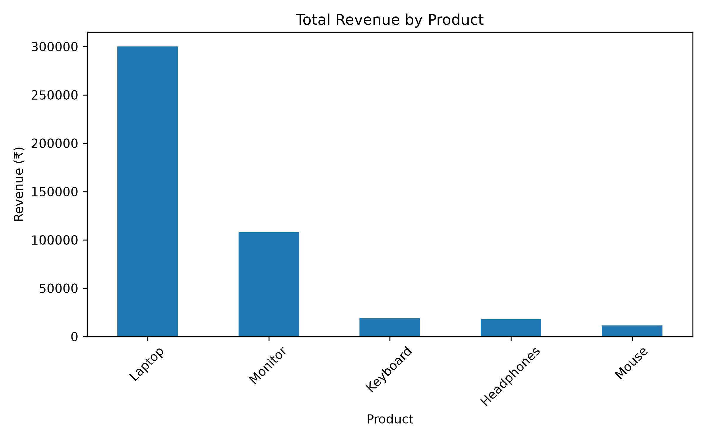
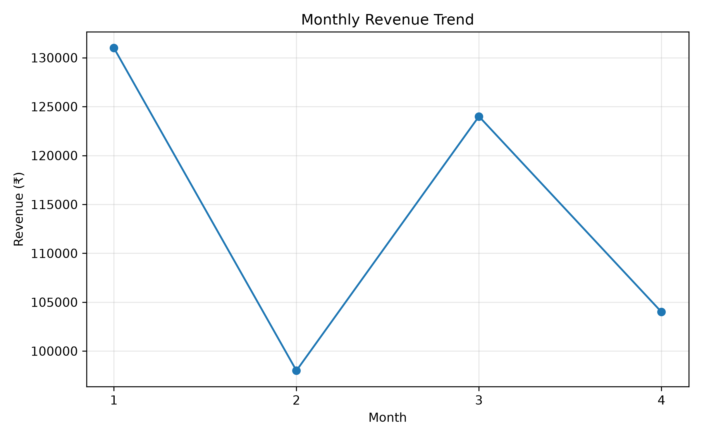

# Retail Store Sales Analysis Using Pandas

## Overview
A beginner-friendly data analysis project using Python and Pandas to analyse retail sales, product performance, regional revenue, and monthly trends.

## Technologies
- Python
- Pandas
- Matplotlib

## Project Structure
- `data/` — Retail sales CSV dataset
- `outputs/` — Product revenue and monthly revenue charts
- `sales_analysis.py` — Main analysis script
- `requirements.txt` — Dependencies

## Visualisations

### Revenue by Product

### Monthly Revenue

## How to Run
1. Install dependencies: `pip install -r requirements.txt`
2. Run the script: `python sales_analysis.py`

## Key Findings
- Analysed 15 retail orders.
- Calculated total revenue and product-wise sales.
- Compared revenue across regions and categories.
- Visualised monthly sales trends using Matplotlib.

## Conclusion
This project demonstrates data exploration, revenue calculation, aggregation, and visualisation using Pandas and Matplotlib.